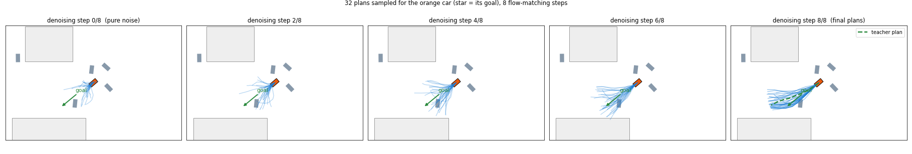
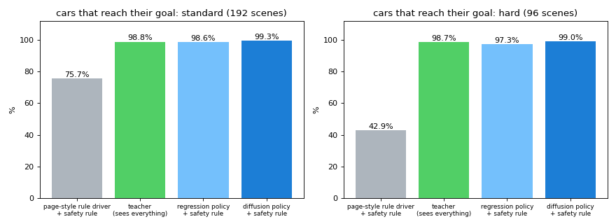

# Diffusion policy for cars

A small flow-matching ("diffusion") policy that drives many cars at once to their own parking spots, around cards and around each other,
including reversing out of jams. It is trained by imitating a privileged planner (the *teacher*) and improved with DAgger.
It runs in the browser (ONNX) and in Python.



*32 plans sampled for one car (orange). Step 0 is pure noise; the plans split into a few routes and settle onto the one the teacher also takes (green dashed).*

## Result

Closed-loop simulation on scenes the models never saw. Every method gets the same scenes. 192 standard scenes (2766 cars) and 96 hard scenes
(2275 cars: crowded, 20-28 cars, gaps of only 44-58 px between cards). "contacts" are new car-car / car-card contacts (body circles touching).

| standard set | cars that arrive | car-car contacts | car-card contacts |
|---|---|---|---|
| page-style rule driver, no safety rule | 99.9% | 545 | 85 |
| page-style rule driver + safety rule | 75.7% (crowds 57%) | 0 | 7 |
| teacher (sees everything, slow) | 98.8% | 1 | 0 |
| regression policy + safety rule | 98.6% | 0 | 0 |
| **diffusion policy (big) + safety rule** | **99.35%** | **0** | **1** |
| diffusion policy (small) + safety rule | 99.24% | 0 | 2 |
| diffusion policy (big), raw | 99.3% | 56 | 8 |

| hard set | cars that arrive | car-car contacts | car-card contacts |
|---|---|---|---|
| page-style rule driver, no safety rule | 97.9% | 1121 | 130 |
| page-style rule driver + safety rule | 42.9% | 0 | 12 |
| teacher | 98.7% | 2 | 1 |
| regression policy + safety rule | 97.3% | 0 | 3 |
| **diffusion policy (big) + safety rule** | **99.0%** | **0** | **3** |
| diffusion policy (small) + safety rule | 99.2% | 1 | 3 |
| diffusion policy (big), raw | 99.0% | 134 | 18 |



What this says, honestly:

* The old failure is real: the rule driver either drives through everything (hundreds of contacts) or, with a safety rule, jams (43-76% arrive).
* The deployed system is **policy + safety rule**. The raw policy still touches about 2% of cars (6% on the hard set); the rule removes those.
* The diffusion policy beats a plain regression policy trained on identical data by 0.8 points of arrival on the standard set and 1.7 on the hard set,
  and the safety rule has to step in about 4 times less often (270 vs 1198 overrides, 740 vs 2320). The gap is real but not dramatic.
* It matches the teacher's arrival rate (the teacher's own failures are cars parked just short of their spot) and is a bit slower
  (mean time to goal 7.4 s vs 7.1 s standard, 9.0 s vs 8.4 s hard).
* It learned to reverse: on the hard scenes 45% of cars reverse at least once (5.3% of driving time); the teacher does it for 28% of cars.
* Things that did **not** help: sampling 8 plans and picking the safe one with most progress (99.7% -> 98.5%, cars rush into jams);
  executing several actions of a plan before re-planning (replanning every 0.25 s cut raw contacts 4x); more than 8 denoising steps.
* Denoising steps (big model + safety rule, 96 scenes): 2 steps 99.2%, 4 steps 99.25%, 8 steps 99.4%, 16 steps 98.95%. So 4 steps would do and halve the cost.

## Use it

```bash
cd policy/web && python3 -m http.server 8001      # then open http://localhost:8001
```
The page spawns cars at your mouse, you can drag the cards, toggle the safety rule, and watch the denoising of one car (thin lines = 24 sampled plans,
dashed = the model's current guess, thick = the plan that is driven). Default model is the small one (~22 ms for 20 cars on one CPU thread, native);
`?model=big` loads the larger network (~53 ms). The page loads onnxruntime-web from a CDN.

In Python:
```python
import policy
pol = policy.StudentPolicy("final/diffusion_policy_big.pt", device="cpu", steps=8, exec_n=1)   # exec_n=1: replan every step
pol.reset(env.n); vt, dl = pol.act(env); env.step(vt, dl, safety=2)                              # safety=2: the stronger rule
```

## What is in here

| file | what |
|---|---|
| `core.py` | car physics (bicycle model, forward and reverse), grid cost-to-go fields, ego observations, teacher rollouts, both safety rules (numba) |
| `env.py` | random scenes (cards, goals, spawn pattern) and the multi-car environment, metrics |
| `teacher.py` | the privileged teacher: prioritised sampling MPC, 512 plans, 3 s horizon, reverse / three-point-turn / creep samples, traffic-aware routes |
| `model.py` | encoder (map crop CNN + route/goal vector + neighbour tokens) and the flow-matching denoiser (also a regression variant) |
| `gen_data.py`, `dagger_gen.py`, `consolidate.py` | dataset generation, DAgger rounds |
| `train.py` | training (EMA, left-right mirror augmentation, loss weight on the first executed actions) |
| `policy.py`, `eval_policy.py`, `final_eval.sh`, `summarize.py` | closed-loop policy, evaluation, the final comparison (`results.txt`) |
| `export.py` | ONNX export with all denoising steps unrolled (also returns every intermediate plan for the visualisation) |
| `web/` | the browser page, `sim.js` (JavaScript port of the simulator, checked against Python: `node web/parity_test.js` shows 0 difference), the ONNX models |
| `final/` | final PyTorch checkpoints (big / small diffusion policy, regression baseline) |
| `LOG.md` | what was done, in order, with numbers |

## How it works

* **Observation of one car** (all in the car's own frame): a 32x32 crop (6 px cells, 192 px wide, looking ahead) with cards, other cars and their velocities;
  the next 6 points of the shortest route to its goal (cost-to-go field, the same thing an A* planner gives the page); goal vector, speed, last action;
  the 6 nearest cars as tokens (relative position, heading, velocity).
* **Action:** 8 steps of (target speed in [-30, 75] px/s, steering angle), 0.25 s per step. Only the first step is executed, then it re-plans.
* **Teacher:** sees every car, plans in the true dynamics with 512 sampled control sequences per car in priority order (higher-priority cars' plans are
  obstacles), and re-routes around standing cars. It can wait, reverse and do three-point turns. 98.8% of its cars arrive, with essentially no contacts.
* **Training:** round 0 = 1.06M teacher decisions with noise injected into the executed actions; then three DAgger rounds where the student drives
  and the teacher labels the states the student reached (3.1M samples in all). Flow matching, 8 Euler steps at inference.
* **Safety rule:** assume every car brakes after the next 0.25 s; any action that would still lead to a contact is replaced by braking (for both cars of a threatened pair).

## Limits

* Trained and tested in simulation on layouts with card sizes 120-230 x 55-100 px, gaps >= 44 px and worlds of 720-1180 x 430-640 px. The page uses 190 x 70 cards in a
  1100 x 520 stage, which is inside that range; very tight gaps, tiny windows and overlapping cards are outside it.
* Contacts without the safety rule are not zero. The "0" in the tables is for policy + rule.
* The student is distilled from the teacher; it can match it but is not expected to beat it. Better than the teacher would need reinforcement learning on top.
* About 4.7 hours of the 8-hour budget were used (teacher + data 1.5 h, four training rounds, evaluation, browser port).
